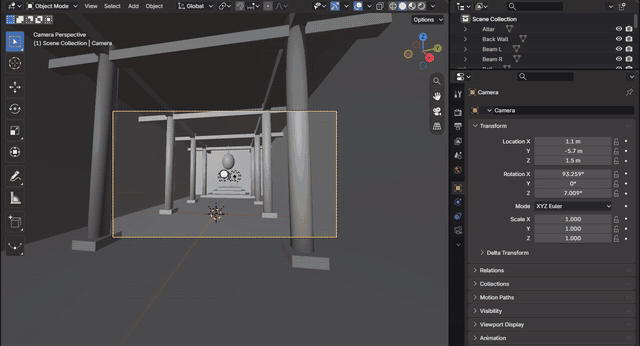
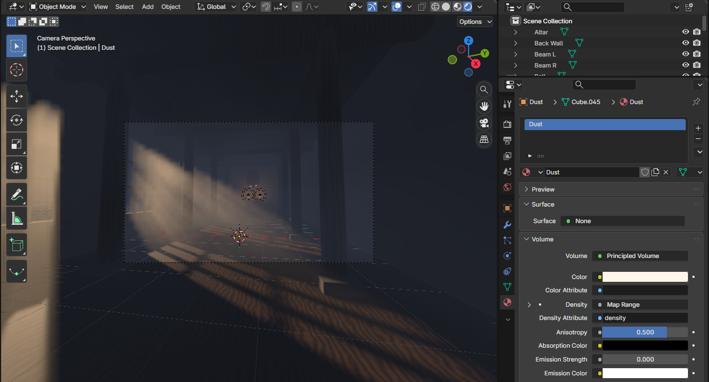
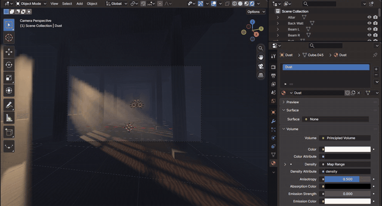
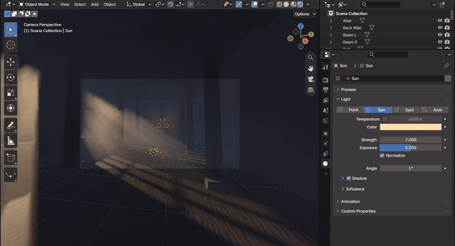
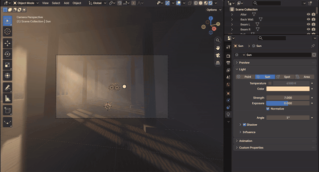
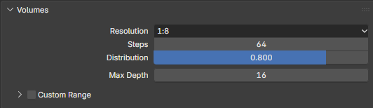
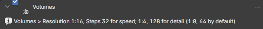
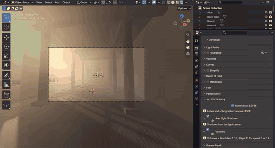
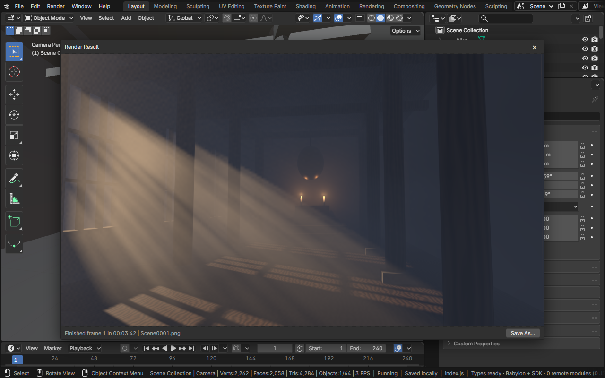

# Volumes

A material's Volume output fills its object with a participating medium: fog, dust, smoke or colored haze that light
scatters in and that dims what is behind it. Bylonder draws it as EEVEE does: the material's Volume shader (Principled
Volume, Volume Scatter, Volume Absorption, and the texture nodes that drive its density) runs in a grid of froxels
over the view, lit by the scene's lights through their shadows and by the world, and integrated toward the camera.
Light shafts are the sun or a spot shadowed by what stands in its way.

[Open in Bylonder](https://propolisa.github.io/bylonder/#example=volumes)

The demo, Temple Light, is made in Blender by a script (`volumes.py`): a temple hall at sunset, a low sun through its
tall windows, columns down the hall and an altar with two candles, all in one box of drifting dust.

## Steps

1. **Rendered shading.** Look through the camera (Numpad 0) and pick Rendered (Z > Rendered). Solid shows the dust's
   box; Rendered fills it with dust, which shows where the sun comes in.

   

2. **The dust.** Select Dust, a box over the whole hall. Its material has no Surface: its Volume is a Principled Volume
   whose Density is a Noise Texture through a Map Range, a faint haze with thicker wisps.

   

3. **Anisotropy.** The Principled Volume's Anisotropy sets which way the dust scatters light: above 0 forward, so the
   shafts glow most when you look toward the sun; below 0 back toward the light.

   

4. **The sun.** Select Sun and press R Z, then move the mouse: the shafts swing across the hall with the sun.

   

5. **Cast Shadow.** The sun's Shadow panel: with Cast Shadow off, the walls stop no light and the whole hall glows;
   on, the windows and columns cut the light into shafts.

   

6. **Volumes settings.** Properties > Render > Volumes: Resolution is the froxels' size against the view's pixels and
   Steps their number in depth; Distribution moves the steps toward the camera. Bylonder reads them as EEVEE
   does, and they trade speed for detail: 1:16 and 32 steps for speed, 1:4 and 128 for detail (1:8 and 64 by
   default), as the Volumes panel (Bylonder icon) says.

   

   

7. **Drifting dust.** The Dust box's location is keyed from the first frame to the last, and its noise moves with it:
   Play (Space) and the dust drifts through the shafts.

   

8. **Render Image.** Render > Render Image (F12) renders through the camera at the output's resolution, its samples
   averaging the dust's slices smooth.

   

## Project files

- [volumes.py](../../examples/volumes/volumes.py): builds the hall, its windows, columns and altar, the dust's volume
  and its drift, the sun and candles, and the camera, in Blender 5.2.
- [volumes.blend](../../examples/volumes/volumes.blend): the file the script saves.
- [index.js](../../examples/volumes/index.js): opens the .blend with Blender's reader.
- Recorded by [record-volumes.mjs](../../tools/docs/record-volumes.mjs).
