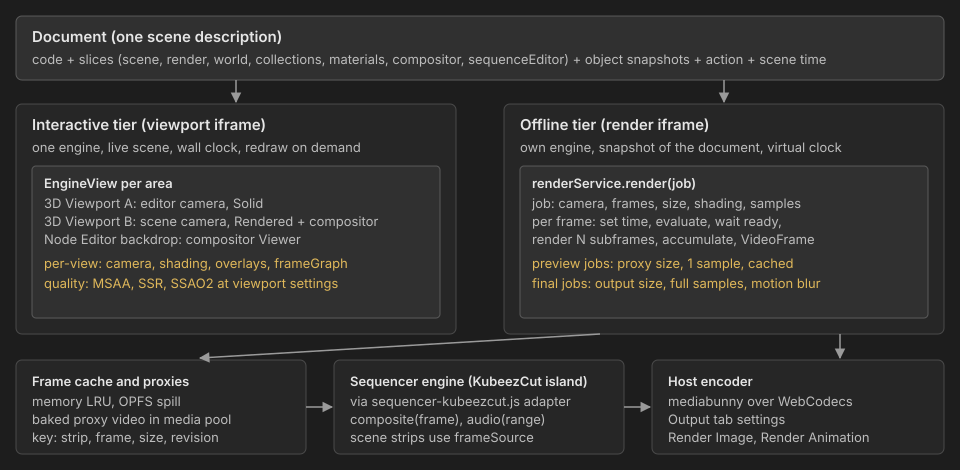

# Rendering beyond realtime: viewports, previews, strips and final renders

Snapshot as of 2026-10-25, on top of `main` at `3c760aa` (scene time, Render and Output tabs, collections). Sources: Babylon 8.32 in `node_modules/@babylonjs/core`, Blender `main` (`space_sequencer.py`, `properties_output.py`), this repository. Items marked "unverified" were not checked against source or a running build. Companion to the [video sequencer proposal](video-sequencer-proposal.md).

## Status

- **Implemented (steps 1 to 3):** render context, virtual clock, Render Image, Render Animation, Render Result, Output tab resolution and file output, render samples with jitter and sub-frame motion blur. Checked in Chromium: the Solar System example (which advances by `getDeltaTime()`) renders identical pixels for the same frame twice and different pixels for the next frame; a 24-frame Render Animation produced WebM (VP9) and MPEG-4 (H.264) files with exactly 24 frames and 1.000 s duration. See the Offline render row in [babylon-blender.md](babylon-blender.md).
- **Findings from the sanity probe:** `getDeltaTime()` only follows the virtual clock when each render is bracketed by `engine.beginFrame()`/`endFrame()`; `scene.render()` alone leaves it at 0. Engine views render only through registered render loops. Per-view `scene.frameGraph` switching works. Differently sized views call `setSize` on every view render, as expected.
- **Encoder:** mediabunny 1.61.4, used unmodified (MPL-2.0 is file-level, so this is fine as a dependency).
- **Step 4 implemented:** multiple 3D Viewports as engine views of one hidden working canvas, sized to an anchor view (the compositor view, else the largest) so it only resizes when the layout changes; other views render into its top-left corner through `camera.viewport`. Checked in Chromium: two side-by-side viewports (Solid and Rendered, perspective and top orthographic), selection and modal moves exact in both (a 60 px gesture moves the object 60 px on screen in each), zero engine resizes during interaction, zero view renders while idle, split areas restored after reload, Render Image unaffected.
- **Findings:** post-process pipelines (MSAA, bloom, custom post processes) respect a camera viewport sub-rectangle; the compositor's frame graph does not (its output lands misaligned), hence the anchor rule and one compositor view at a time. Babylon's view observables are module-level, shared by every engine in a page.
- **Step 5 partly:** the compositor shows in the last clicked rendered viewport. A backdrop in the Node Editor is not done yet.
- **Sequencer step 6 started:** KubeezCut fork set up (`Propolisa/KubeezCut`, branch `bylonder`): AI features compiled out (`VITE_AI_FEATURES=false`; Whisper, Gemma, RNNoise and Kitten TTS code is absent from the embed), a library build with island mounts and a first host contract, scoped styles, popups in a scoped portal. Bylonder shows it as Video Sequencer and File Browser editors. Checked: islands load in dev and in the production build under `/bylonder/`, media import works. Placing a clip crashes headless Chromium in this container, standalone KubeezCut included, so playback needs a check in a desktop browser.
- **Next:** the `sequenceEditor` slice and adapter (edit stored with the project, undo through Bylonder), strip channels, Blender icons and shell for the islands, then scene strips.

## Summary

Babylon is a realtime engine, but nothing in it forces realtime. What makes Bylonder realtime today is how we drive it: one canvas, one camera, one evaluated state, wall-clock time, and a quality budget set by frame rate. The proposal splits rendering into two tiers that share one scene description:

- **Interactive tier**: one engine, many views. Every 3D Viewport, the compositor backdrop and camera previews are views of the live scene, each with its own camera and shading. Redrawn on demand.
- **Offline tier**: one render service. Render Image, Render Animation, sequencer scene strips and thumbnails all ask it for frames. It runs a separate copy of the project built from a document snapshot, on a virtual clock, at any resolution, with as many samples as the job allows. Results are cached and can be baked to proxy video.

The KubeezCut sequencer sits on top of both through narrow contracts and never touches Babylon. Encoding belongs to the host, so Render Animation uses one encoder whether or not the sequencer is involved.



## What currently ties us to realtime

| Constraint | Where | Effect |
| --- | --- | --- |
| Wall-clock time in user code | `src/workspace/examples.js:58` advances the Solar System by `scene.getEngine().getDeltaTime()` | The same frame renders differently on a slow and a fast machine |
| One evaluated state | Animation evaluation writes live objects (`src/animation/model.js`) | The viewport and a render cannot show different frames at the same time |
| One canvas and one camera | `src/main.js` renders `world.scene.render()` in `runRenderLoop` | One 3D Viewport |
| Rendered gate is global | `world.setViewportRendered` switches world, render effects and compositor together | Solid and Rendered viewports cannot coexist |
| Compositor is scene-global | `scene.frameGraph = ...` replaces the scene's render function (`scene.js`, `customRenderFunction = this._renderWithFrameGraph`) | Every view would show the compositor output |
| Quality tied to frame rate | Render tab maps Samples to MSAA, Raytracing to SSR, Fast GI to SSAO2 | No way to spend more time for a better final frame |

## Interactive tier: one engine, many views

**Mechanism.** Babylon's `engine.registerView(canvas, camera)` (`EngineView`, see the [multi-canvas docs](https://doc.babylonjs.com/features/featuresDeepDive/scene/multiCanvas)) renders the scene once per view into the engine's working canvas and copies it to the view's canvas with a 2D `drawImage`. `onBeforeViewRenderObservable` runs before each view's render, which is where per-view state is applied. `engine.inputElement` routes input to the hovered view.

Per-view state, applied in that hook and restored after:

| State | Blender equivalent | Applied as |
| --- | --- | --- |
| Camera (editor camera or scene camera) | View3D region, camera view | `view.camera` |
| Shading: Wireframe, Solid, Material, Rendered | View3D shading | The rendered gate becomes per view: world background and fog, render effects (camera-attached pipelines on that view's camera only) and compositor |
| Compositor in camera view | Viewport compositor | Set `scene.frameGraph` for that view, clear it for others (switching is cheap; correctness per view is unverified) |
| Overlays (grid, outlines, gizmos) | Overlays popover | `layerMask` or `renderingGroupId` per view camera |
| Local view, collection visibility | Local View, viewport visibility | Camera `layerMask` |

**Redraw on demand.** Blender redraws a region only when something it shows changes. Each view keeps a dirty flag set by camera moves, document changes, frame changes and playback; the render loop renders only dirty views. During playback all views showing animated content redraw; idle views cost nothing.

**Known cost.** `_renderViewStep` resizes the working canvas when the next view has a different size (`abstractEngine.views.js`), which reallocates post-process targets. With two differently sized Rendered viewports that happens twice per frame. Mitigations, in order: on-demand redraw (most frames render one view); keep render effects only on Rendered views; if measurements show stalls, render all views into one working canvas sized to the largest view using `camera.viewport` regions and copy subrectangles (unverified, needs a prototype).

Everything here runs inside the existing viewport iframe on the existing engine. No second WebGL context.

## Compositor previews

| Blender | Bylonder |
| --- | --- |
| Viewport compositor (camera view, Rendered) | A view whose camera is the scene camera with the frame graph enabled, as above |
| Compositor backdrop and Viewer node | A view in the Node Editor area at output aspect and a preview percentage; the Viewer target is the frame graph's output texture |
| Render Result after F12 | Offline tier, below |

Interactive previews run at viewport quality. A full-quality still of the composite is a Render Image job.

## Offline tier: the render service

**Render context.** A hidden iframe that runs the project like `viewport.html` does, then applies a full `document.capture()` snapshot plus object snapshots and the action. It has its own engine on its own canvas, sized to the job, so the user's viewports are untouched. This is Bylonder's equivalent of Blender rendering from its own evaluated depsgraph. It also gives a useful rule: if a state is not in the document, it does not render. That rule will expose any subsystem whose `capture`/`apply` is incomplete.

**Virtual clock.** Installed in the render context before user code runs:

| Source of nondeterminism | Fix |
| --- | --- |
| `performance.now`, `Date.now` (Babylon's `PrecisionDate.Now` reads `performance.now`) | Return job time: `frame / fps` plus sub-frame offset |
| `requestAnimationFrame`, `runRenderLoop` | Never tick; the job calls `scene.render()` once per sample |
| `engine.getDeltaTime()` | Constant `1000 / fps` per frame (divided by subframes when accumulating) |
| Babylon animations | Advance by `getDeltaTime()`, which follows the clock; our action is evaluated at the job frame |
| Physics | Fixed step per frame (`deterministicLockstep` engine option or the plugin's fixed time step) |
| `Math.random` | Seeded per job and frame |
| Async loading (textures, fonts, node materials) | Wait for `scene.whenReadyAsync()` before each frame |

Same project, same machine, same browser: identical frames. Bit-identical results across GPUs or drivers are not promised, the same as Blender's GPU renderers.

**Per-frame procedure.** Set time and frame, evaluate the action, render N samples (each bracketed by `engine.beginFrame()`/`endFrame()`), accumulate, emit one frame with a timestamp of `index / fps`. Frames are pre-rolled from Frame Start so code that integrates time reaches the same state. The canvas is read right after `scene.render()` in the same task, so `preserveDrawingBuffer` is not needed.

**Samples mean something offline.** Blender separates viewport samples from render samples. We do the same:

| Render setting | Viewport (interactive tier) | Final (offline tier) |
| --- | --- | --- |
| Samples | MSAA, as today | N jittered subframes accumulated in a float target (supersampling and temporal anti-aliasing; Babylon's `TAARenderingPipeline` accumulates the same way for static frames) |
| Motion Blur, Shutter | `MotionBlurPostProcess` approximation | True sub-frame blur: subframes spread across the shutter interval with the action, physics and user code evaluated at each sub-frame time |
| Raytracing, Fast GI | SSR, SSAO2 at viewport settings | Same effects at higher quality settings; IBL shadows accumulate over subframes |
| Resolution | View size times hardware scaling | Output resolution and percentage (Output tab, to add) |

This answers "Babylon is not a renderer" for our purposes: the final render is Babylon run offline, on a virtual clock, with time budget spent on samples.

## Sequencer scene strips

Blender's sequencer has the settings we need, and they map directly:

| Blender | Bylonder |
| --- | --- |
| Scene strip Display: Shading (`sequencer_gl_preview`: Wireframe, Solid, Material, Rendered), Override Render Settings | Strip preview shading passed to the render service as the job's shading |
| Proxy Render Size (None, Scene, 25%, 50%, 75%, 100%) | Job resolution for preview frames |
| Cache: Raw, Final; Prefetch | Frame cache of render-service frames (raw) and composited frames (final); prefetch ahead of the playhead when idle |
| Proxies (Setup, Rebuild) | Bake: encode a scene strip's frames to a proxy video (WebCodecs) in the media pool; the strip then plays like a movie strip |

Three levels, cheapest first:

1. **Cached frames.** Memory LRU of `VideoFrame`/`ImageBitmap`, spilling to OPFS. Key: strip, frame, resolution, shading, and a scene revision hash from the document and action. Any document change invalidates only the affected scene's entries.
2. **Live frames.** Rendered on request by the render service at proxy size with preview samples (1). Prefetch fills the cache ahead of the playhead.
3. **Baked proxy.** An encoded video stored with its revision hash. Shown with a stale marker when the scene has changed since baking, as Blender shows outdated proxies.

The final render always re-renders scene strips at output resolution and full samples; caches and proxies are preview-only.

## Final output: Render Image and Render Animation

1. Render service produces frames for the scene camera (or for each scene strip when Post Processing > Sequencer is on and the sequencer has strips).
2. With the sequencer on, the sequencer engine composites strips for each frame (KubeezCut's canvas renderer, GPU effects and transitions) and supplies mixed audio.
3. The host encoder (mediabunny over WebCodecs) writes the file using the Output tab's container, codecs and quality; image formats write per-frame files.
4. Render Result shows progress and the last frame. Cancel stops the job between frames.

## Interaction model: swappable sequencer

Following the scene-level data pattern in [babylon-blender.md](babylon-blender.md):

- **Record.** A `sequenceEditor` document slice shaped like Blender's (`strips` with `channel`, `frameStart`, `frameOffsetStart`, `frameOffsetEnd`, `blendType`, `blendAlpha`, `transform`, `crop`, `modifiers`, typed data per strip type). Fields only KubeezCut understands live under `strip.ext.kubeezcut`, kept on round trip and ignored by others.
- **One adapter.** `src/sequencer/sequencer-kubeezcut.js` is the only code that imports the fork. It maps the record to KubeezCut's stores, maps KubeezCut actions back to slice methods, and implements the engine contract below. Replacing KubeezCut means writing another adapter.
- **Channels.** Strip properties register channels with datablock-relative paths (`scene` + `sequenceEditor.strips["Name"].blendAlpha`, in the style of Blender's RNA paths). The island reads animated values through the host; the record holds unanimated values.
- **Contracts.** Small, framework-free, owned by Bylonder:

```js
// Host provides
frameSource = { getFrame({ stripId, frame, width, height, shading, samples }) }; // resolves to a VideoFrame
renderService = { render(job) };       // async iterator of VideoFrame; used by F12, Ctrl F12, strips, thumbnails
encoder = { open(outputSettings), write(videoFrame, audioData), close() }; // resolves to a file

// Sequencer engine provides (KubeezCut adapter today)
sequencerEngine = {
  mount(element, view),                // 'sequencer' | 'preview' | 'media' island
  composite({ frame, width, height }), // resolves to a VideoFrame of the final edit
  audio({ start, end, sampleRate }),   // resolves to AudioData for the range
  dispose(),
};
```

KubeezCut's export currently decodes, composites and encodes in one pass (`client-render-engine.ts`). The one fork change this needs is to stop at the composited frame and audio and let the host encoder finish, so the encoder is shared with plain 3D renders.

**Island styling.** Per the current decision, KubeezCut views run as React islands. Overrides stay in one stylesheet scoped to the island root: shadcn CSS variables mapped to `src/theme.css` tokens, font and sizes from our theme, focus and selection colors from Blender's theme. Icons and widget shapes stay KubeezCut's for now. The [Vue port analysis](video-sequencer-proposal.md#porting-the-ui-to-vue) remains the plan if the islands prove limiting.

## Plan

| Step | Deliverable | Done when |
| --- | --- | --- |
| 1. Render context and virtual clock | Hidden render iframe from a document snapshot; time shims; `renderService.render` for stills | The Solar System example renders the same frame 10 times with identical pixels |
| 2. Render Image and Render Animation | Output tab resolution and file format; host encoder; Render Result area | A keyed example exports MP4 and WebM with the exact frame count; cancel works |
| 3. Offline samples | Subframe accumulation; true motion blur; quality settings for final | Final frames are visibly smoother than viewport frames at the same settings |
| 4. Multiple viewports | `EngineView` per 3D Viewport area; per-view shading, camera, overlays; on-demand redraw | Solid and Rendered viewports side by side; idle viewport costs no frames |
| 5. Compositor previews | Per-view frame graph; backdrop view in Node Editor | Viewer shows the composite while the main viewport stays Solid |
| 6. Sequencer island and adapter | `sequenceEditor` slice, KubeezCut adapter, themed islands | Edit, undo, reload and ZIP round trip keep the edit |
| 7. Scene strips | `frameSource` over the render service; cache, prefetch, proxy sizes, bake | Scrubbing a scene strip at 25% is interactive after prefetch; final render uses full quality |
| 8. Sequencer output | Composite and audio through the shared encoder | An edit mixing a movie and a scene strip renders frame accurately |

Steps 1 to 5 do not depend on KubeezCut and can start now.

## Risks and open questions

- **Memory.** The render context loads the whole project a second time. Large projects may need it created per job and disposed after.
- **Snapshot completeness.** Interactive state not captured by document slices (for example editor-only toggles, unsaved Babylon editor graphs) will be missing from renders. That is intended, but users need a clear message when it bites.
- **User code with side effects** (network requests, timers) runs again in the render context. The time shims cover timers driven by our clock; network calls are the user's responsibility.
- **Two GPU contexts for the sequencer.** Scene strip frames cross from WebGL2 (Babylon) to WebGPU (KubeezCut compositor) as `VideoFrame` copies. Fine at preview sizes; at 4K the final render pays one copy per frame.
- **View resizing cost** as described above, until measured.
- **Per-view frame graph** switching is plausible from Babylon's source but untested.
