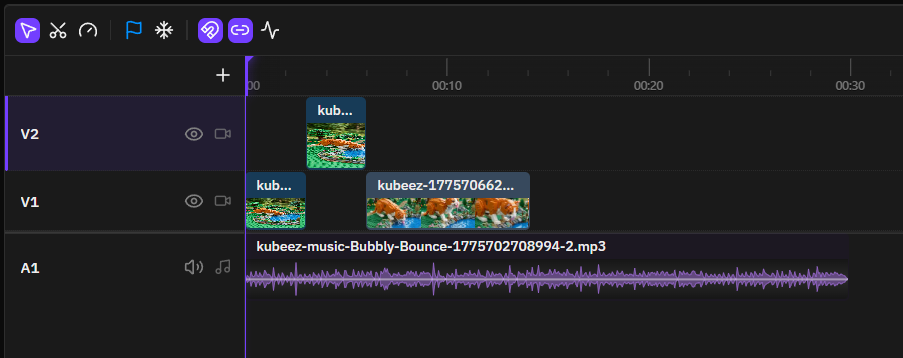
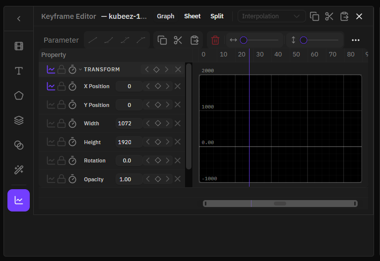
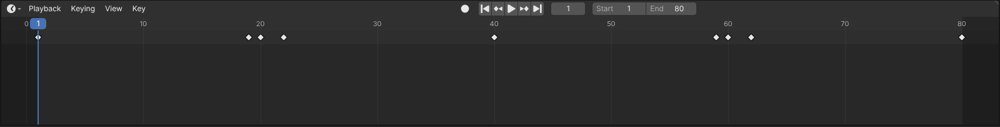
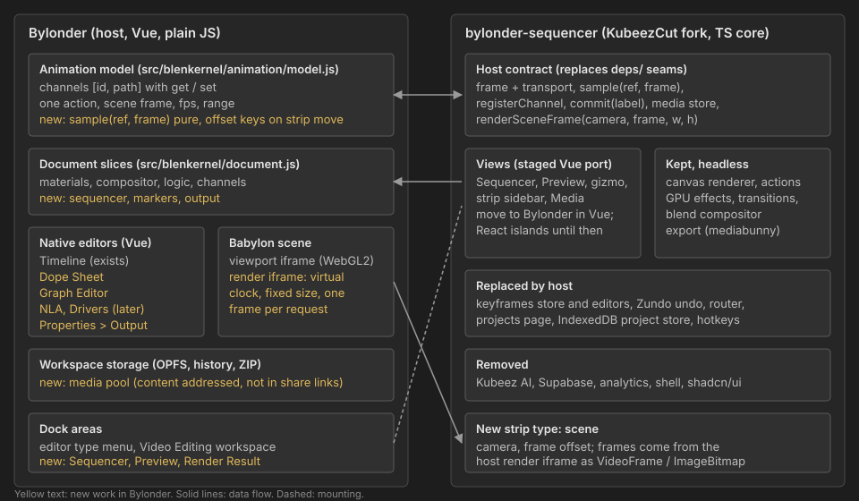
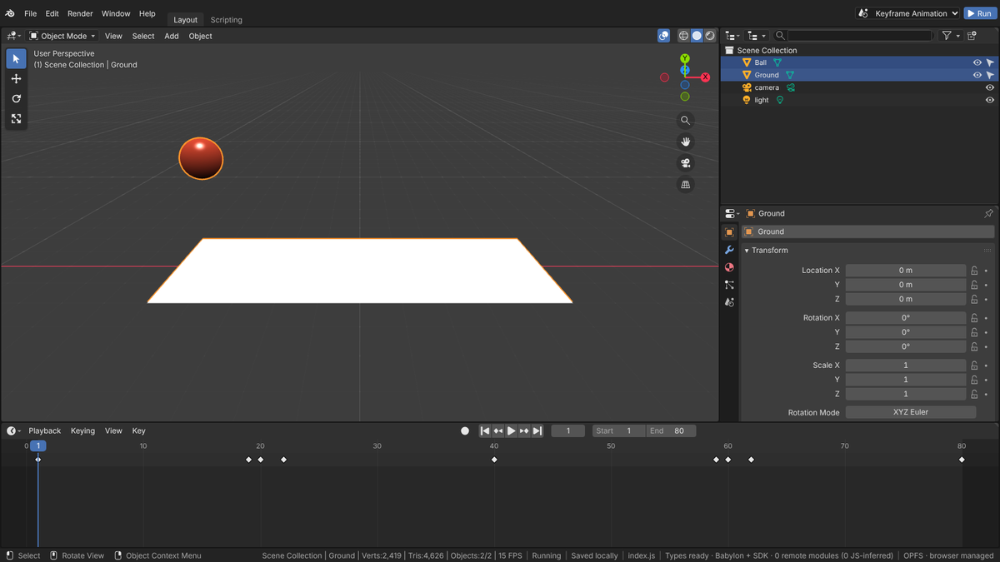

# Video Sequencer and render output: KubeezCut assessment and proposal

Snapshot as of 2026-10-25. Sources: KubeezCut `main` at commit `3aa8741` (2026-08-06), Blender `main` (`scripts/startup/bl_ui/space_sequencer.py`, `properties_output.py`), this repository. Items marked "unverified" were not checked against source or a running build.

## Summary

Status (2026-10-26): phases 2, 3 and 5 are done (fork, Sequencer and Preview areas with the edit in the scene's `sequenceEditor` slice, Bylonder undo and clock, Blender keymap, menus and icons, scene strips, sequencer output through the shared encoder); see the [render architecture status](render-architecture-proposal.md#status). Media stays in KubeezCut's per-project library rather than a host media store. Phase 4 (strip channels) is next.

Decision (2026-10-25): KubeezCut views run as React islands with scoped style overrides for now; the Vue port below is kept as analysis for later. The sequencer sits behind a Blender-shaped `sequenceEditor` record and one adapter so it can be replaced. Contracts, scene strips, multiple viewports and deterministic rendering are in the [render architecture proposal](render-architecture-proposal.md), which supersedes the host contract sketched here.

- KubeezCut covers most of Blender's Video Sequencer (strips, channels, preview, transitions, effects, blend modes, markers, meta strips) and a WebCodecs export pipeline. It is a good base for the **Sequencer**, **Preview** and the encoding half of **Render Animation**.
- It does not cover the Dope Sheet, Graph Editor, NLA or Drivers in a form we can use. Its keyframe editor animates 8 fixed clip properties; ours animates any registered channel. Those editors should be built natively over `src/animation/model.js`, with the sequencer's strip properties registered as ordinary channels so they show up there, as in Blender.
- A fork is needed. The parts to replace are the ones that define our UX: keyframe store, undo, project storage, keymap, styling and app shell. The rendering, compositing and export core can stay close to upstream.
- Porting the UI from React to Vue and our Blender component library is moderate. Raw `.tsx` volume is large, but the core scope is 112 components in 93 files plus 27 hook modules, and only about 9,000 of its lines are React-specific (JSX and hook wrappers); the rest is plain TypeScript inside components, comments, imports and brackets. Core scope is estimated at 1.5 to 2.5 engineer-months, full parity at about 3 to 4. About 96,000 lines of framework-free TypeScript (timeline actions, export engine, GPU libraries, media services) are reused unchanged. The recommended route is a staged port that starts with the cheap panels and ends with the timeline, see [Porting the UI to Vue](#porting-the-ui-to-vue).
- glTF (GLB) is the interchange format with Blender. Every channel and feature gets a glTF class (native, pointer extension, baked, not exported) so exports can report what is lost; see [glTF interop constraint](#gltf-interop-constraint).
- Correction to the brief: Bylonder does not use WebCodecs yet. A search of `src/`, `public/` and `scripts/` finds no `VideoEncoder`, `VideoFrame`, muxer or `MediaRecorder` use. Today's only render setting is hardware scaling (`src/workspace/render-settings.js`). WebCodecs would arrive with the fork (through mediabunny).

## KubeezCut facts

| Item | Value |
| --- | --- |
| License | MIT. Built on FreeCut (MIT) with patterns from OpenCut. Encoder/decoder dependency mediabunny is MPL-2.0 (file-level copyleft; fine as a dependency) |
| Stack | React 19, TypeScript 5.9, Tailwind 4, shadcn/ui (Radix), Zustand 5 with Zundo undo, TanStack Router, Vite 6 |
| Size | 1,194 files under `src/`, about 228,000 lines of TypeScript including 211 test files. Bylonder `src/` is about 8,300 lines of JavaScript |
| Largest modules | timeline 51k lines, preview 21k, editor shell 16k, export 12k, media library 12k, composition runtime 10k, keyframes 10k |
| Rendering | WebGPU effects, transitions (13), 25 blend modes, scopes; Canvas 2D fallback for transitions only. Effects are GPU-only |
| Export | mediabunny over WebCodecs. Containers MP4, WebM, MOV, MKV; video H.264, H.265, VP8, VP9, AV1; audio AAC, Opus, MP3, PCM. Runs in a worker, with a main-thread path. ProRes falls back to H.264 |
| Media | File System Access handles plus OPFS proxies and IndexedDB; relinking; Whisper transcription; scene detection |
| Browsers | README requires Chrome or Edge 113+ (WebGPU, WebCodecs, OPFS, File System Access) |
| Not needed here | Kubeez AI generation and account (99 files reference it), Supabase, Vercel analytics, TTS, marketing pages |

Data model: tracks hold items, a discriminated union `video | audio | text | image | shape | adjustment | composition`, positioned by `from` and `durationInFrames` in project frames. Transitions are attached between adjacent clips. Pre-compositions nest one level. Keyframes are stored per item and property, with frames relative to the item start and easing `linear | ease-in | ease-out | ease-in-out | cubic-bezier | spring`.

The keyframable set is fixed in `src/types/keyframe.ts`: `x, y, width, height, rotation, opacity, cornerRadius, volume`. Effect parameters declare `animatable: true` in `src/lib/gpu-effects/effects/*.ts`, but nothing reads that flag; effect values cannot be keyed today.



*KubeezCut timeline: tracks V1, V2, A1 with filmstrips and a waveform (upstream screenshot, MIT).*



*KubeezCut keyframe editor: graph, sheet and split views over the fixed Transform property list of one clip.*



*Bylonder Timeline today (Keyframe Animation example): one action, keys for any channel, Blender header and transport.*

## Overlap with Blender editors

| Blender editor | Bylonder now | KubeezCut | Proposed source |
| --- | --- | --- | --- |
| Timeline | Yes: transport, summary keys, channel region, auto key | Its timeline is a sequencer, not a scene timeline | Keep ours. Add markers and preview range |
| Dope Sheet | No (Timeline has a channel region) | "Sheet" view, per clip, 8 properties | Native Vue editor over channels. Reuse marquee and snapping logic only if it ports cleanly |
| Graph Editor | No (no handle editing) | Bezier value graph, per clip | Native Vue editor over channels. `bezier-utils.ts` and `value-range-utils.ts` are framework-free and can be ported |
| NLA | No | No (pre-comps are meta strips, not NLA) | Ours, after action slots. Maps onto `AnimationGroup` weight, `isAdditive`, `from`/`to`, `speedRatio` (see [concepts](concepts.md)) |
| Drivers | No | No | Ours. Keep drivers as pure functions of channels so they can be baked |
| Video Sequencer: Sequencer view | No | Yes: tracks, trim, split, ripple, roll, slip, slide, snapping, markers, rate stretch, pre-comps | Fork |
| Video Sequencer: Preview view | No | Yes: canvas preview, transform gizmo, corner pin, masks, scopes, source monitor | Fork |
| Sequencer strip sidebar | No | Item properties panels | Fork, rebuilt on our property rows so decorators and keying work |
| Properties > Output | Frame Rate and Frame Range on scene time (`main`); no resolution or file output | Export dialog, project canvas presets | Ours (UI), fork (encoder) |
| Render > Render Animation, Render Result | No | Export dialog with progress | Ours (operator and Render Result area), fork (engine) |
| Compositor | Yes (Node Render Graph) | Per-clip GPU effects | Keep ours for scene output. Fork effects become strip modifiers |

Strip types, Blender against KubeezCut:

| Blender | KubeezCut | Gap |
| --- | --- | --- |
| Movie, Sound, Image/Sequence | video, audio, image (GIF/WebP animated) | Image sequences |
| Color, Text, Adjustment Layer | shape, text, adjustment | Color strip is a shape fill |
| Scene | none | New `scene` item: renders our Babylon scene from a camera. This is the main reason to marry the two |
| Meta | composition (1 level) | Deeper nesting |
| Crossfade, Gamma Crossfade, Wipe, Sound Crossfade | transitions (fade, wipe, dissolve and 10 more) | Blender models these as effect strips over overlaps; KubeezCut attaches them to cuts. Keep the KubeezCut model; present it in Blender terms |
| Add, Subtract, Multiply, Alpha Over/Under, Color Mix | 25 blend modes per item | Equivalent through blend mode and opacity |
| Glow, Gaussian Blur, strip modifiers | GPU effects | Present as strip modifiers in the sidebar |
| Speed Control, retiming keys | rate stretch | Retiming keys |
| Compositor strip | none | Later: run our Node Render Graph on a strip |
| Multicam, Mask, Clip | none | Out of scope |

Blender 5.x shows a workspace-level `sequencer_scene` in the Video Editing workspace (`space_sequencer.py`), so the edit can live apart from the scene being modeled. With one Babylon scene per run, we treat the sequencer as part of the project document and the Scene strip as a camera render of the project scene.

## Why a fork, and what changes in it

Embedding KubeezCut unchanged (iframe or package) would give a second keyframe system, a second undo stack, IndexedDB projects beside our OPFS projects, Premiere-style shortcuts and shadcn styling. That fails the goal that everything is animatable and looks and behaves like the rest of Bylonder.

Fork changes, in order of importance:

1. **Animation.** Remove the keyframes store, its editors and the `auto-keyframe`/`animated-transform-resolver` path. Every strip property (transform, crop, opacity, volume, text, color, every effect parameter including those flagged `animatable`) registers a channel `strip:<stripId>` with a path such as `transform.x` or `effects.<id>.amount`. Rendering reads values through a host `sample(ref, frame)`. Keys live in our action at absolute scene frames; moving a strip offsets its keys, as Blender does. KubeezCut's easing presets become key interpolation modes in our model.
2. **Undo and persistence.** Replace Zundo with our history: the `execute()` wrapper in `timeline/stores/actions/shared.ts` ends with a host `commit(label)`. Tracks, items, transitions, markers and compositions are stored in a `sequenceEditor` document slice (shaped like Blender's, see the [render architecture proposal](render-architecture-proposal.md#interaction-model-swappable-sequencer)), so Remember scene edits, project versions and ZIP export work without new wiring.
3. **Clock.** Our scene frame is the only playhead. The fork's playback store follows the host frame and requests play, pause and seek through the host.
4. **Shell.** Drop the router, projects page, settings page and `react-resizable-panels` shell. Editors mount as `(element, host) => {dispose}`, matching `dock.setFactory`: Sequencer, Preview, Media.
5. **UI.** Current decision: kept views run as React islands with one scoped stylesheet mapping shadcn CSS variables to `src/theme.css` tokens. A later Vue rewrite on our component library is costed in [Porting the UI to Vue](#porting-the-ui-to-vue).
6. **Keymap.** Use Blender's sequencer keys (G move, K split, Shift K hard split, Shift D duplicate, X delete, Shift A add, Tab meta, Ctrl G make meta) through our shortcut registry. KubeezCut tools (ripple, roll, slip, slide, razor) stay as toolbar tools.
7. **Media.** Replace IndexedDB projects with a host media store: content-addressed files in OPFS beside project versions, excluded from share links, optional in ZIP export. Keep KubeezCut's proxies and relinking.
8. **Removal.** Kubeez AI, Supabase, analytics, TTS. Whisper transcription is optional.

Keep the fork's existing `deps/` contract seams and feature boundaries. Put our changes behind those seams so upstream merges stay tractable.

## Proposed architecture



The fork is a separate repository (`bylonder-sequencer`) built as an ESM library and consumed here as a pinned dependency. Reasons: it is about 27 times our source size, it is TypeScript, and our ChatGPT upstream sync and Download App Source archive should not carry it. The fork exports its framework-free core (stores, actions, render and export engine) and, during the port, React islands for views not yet in Vue. Islands are not new here: the Babylon node editors bundle their own React. The Vue views live in this repository next to the other editors.

Host contract as first sketched (superseded by the contracts in the [render architecture proposal](render-architecture-proposal.md#interaction-model-swappable-sequencer)):

```js
{
  frame, fps, range, play(), pause(), seek(frame), onFrame(fn),
  registerChannel({ id, path, label, get, set }), sample(ref, frame),
  commit(label), document: { capture, apply },
  media: { put(file), get(hash), url(hash) },
  renderSceneFrame({ camera, frame, width, height }) // resolves to a VideoFrame
}
```

Scene strip: frames come from a hidden **render iframe** that runs the project like `viewport.html` but with a virtual clock (`performance.now`, `requestAnimationFrame` and `engine.getDeltaTime` driven per frame), a fixed canvas size and `scene.render()` per request. The frame is captured with `new VideoFrame(canvas)` right after render, then handed to the fork's compositor. A separate iframe keeps the 3D viewport untouched when the sequencer shows another frame, which is what Blender's separate depsgraph gives. User code that reads wall-clock time directly is not deterministic; document this and detect it where possible (unverified how much real projects rely on it).

## Render settings and output

Blender keeps resolution, frame rate, frame range and encoding on the scene (`properties_output.py`). On `main`, scene time (`src/scene/time.js`) already holds fps and range and the Output tab edits them. The rest of Properties > Output to add:

| Blender panel and field | Our implementation |
| --- | --- |
| Format: Resolution X, Y, %, Frame Rate (with 23.98, 29.97 presets) | Output size independent of the viewport; fps and `fps_base` |
| Frame Range: Start, End, Step; preview range | Scene range, shared by Timeline, Dope Sheet and Sequencer |
| Output: path, File Format (FFmpeg Video, PNG, JPEG, WebP) | Save via File System Access or download; image sequences zipped |
| Encoding: Container | MP4, WebM, MOV, MKV (mediabunny) |
| Video: Codec, Output Quality, Encoding Speed, Keyframe Interval | H.264, H.265, VP8, VP9, AV1; quality presets map to bitrate, `quantizer` mode where supported (unverified per codec); `latencyMode`; key frame interval |
| Audio: Codec, Channels, Sample Rate, Bitrate, Volume | AAC, Opus, MP3, PCM; options greyed out when `canEncode` fails |
| Post Processing: Compositing, Sequencer | Same switches: with Sequencer on and strips present, output is the edit; otherwise the camera render through the compositor |

Render menu: Render Image (F12), Render Animation (Ctrl F12), View Render (F11). Render Result is a dock area showing progress and the last frame. Unsupported codecs come from `VideoEncoder.isConfigSupported`, as KubeezCut already checks. The existing Render Resolution dialog becomes a viewport preference, separate from output resolution.

## Porting the UI to Vue

Measured on commit `3aa8741`, excluding tests:

| Part | React (`.tsx` plus hooks) | Plan | Raw lines in scope |
| --- | --- | --- | --- |
| Timeline (Sequencer view) | 17,070 tsx, 7,242 hooks | Port | 24,300 |
| Preview, gizmo, masks, corner pin, edit overlays, scopes | 14,118 tsx, 1,207 hooks | Port | 15,300 |
| Composition runtime and player (Remotion-style React tree driving DOM video) | 6,634 tsx, 708 hooks | Replace with the canvas renderer, see below | 0 to 7,300 |
| Media library | 3,926 tsx | Port as Media area | 3,900 |
| Effects panels | 1,619 tsx, 236 hooks | Port onto property rows | 1,900 |
| Shared components | 2,316 tsx | Port what the above use | up to 2,300 |
| Keyframe editors | 7,330 tsx | Dropped, replaced by native Dope Sheet and Graph Editor | 0 |
| Strip sidebar (`editor/components/properties-sidebar`), transitions picker, toolbar, audio meter | 6,896 tsx | Port onto our property rows | 6,900 |
| Rest of editor shell, routes, projects, settings, export dialog | about 10,700 tsx | Dropped, replaced by dock, Properties > Output | 0 |
| shadcn/ui, Kubeez, marketing | about 8,600 tsx | Dropped, replaced by our components | 0 |
| **Total** | **79,958 tsx plus about 11,000 hook lines** | | **45,000 to 55,000** |

Reused unchanged: about 96,000 lines of `.ts` that do not import React (timeline actions and services, export and render engine, GPU effects, transitions, compositor, scopes, media services, migrations). Zustand stores work outside React through `getState()` and `subscribe()`; a small adapter exposes them to Vue as reactive refs.

Where the lines are. Markup is a small share; most `.tsx` lines are event handlers, imperative render loops and features we may not need:

| File | Lines | JSX lines (approx.) | What fills it |
| --- | --- | --- | --- |
| `preview/components/video-preview.tsx` | 5,445 | about 110 | Playback and scrub render loop, prewarm, transition holds, DOM video sync; 603 `ref.current` uses |
| `timeline/components/timeline-item/index.tsx` | 3,613 | about 250 | About 45 handlers: click, drag, trim, fade and volume handles, transition drop zones, context menu actions (captions, scene detection, AI audio, pre-comps) |
| `preview/components/mask-editor-overlay.tsx` | 2,139 | about 15 | Mask path editing |
| `timeline/components/keyframe-graph-panel.tsx` | 1,615 | | Keyframe editor docked under the timeline |
| `timeline/components/timeline-content.tsx` | 1,315 | about 60 | Scroll, zoom, marquee, virtualization |
| `preview/components/source-monitor.tsx`, `source-composition.tsx`, `edit-2up-panels.tsx`, `edit-4up-panels.tsx` | 2,365 | | Source monitor and trim comparison views |
| `timeline/hooks/*` | 7,242 | 0 | Drag, trim, rate stretch, slip and slide. Few React hooks (for example 9 in the 777-line trim hook); mostly imperative code over refs that becomes Vue composables almost line for line |

The edit math itself (placement, collisions, ripple, roll, slip, slide, transition placement and repair, compositions) is already in about 19,500 lines of framework-free actions, utils and services under `timeline/`, which are reused. Transition rendering is also not React: the WebGPU shaders (`lib/gpu-transitions/`, 1,475 lines) and the transition engine with its Canvas 2D fallback (`domain/timeline/transitions/`, 1,958 lines) are reused unchanged. The React side only feeds them frames, which the canvas render loop takes over.

Consequences:

- **Preview playback.** `video-preview.tsx` renders `MainComposition` through a Remotion-style `Player`, `Sequence` and DOM video elements, with a canvas renderer (`createCompositionRenderer`, shared with export) used for scrubbing. Driving both playback and scrub through the canvas renderer, fed by the existing `VideoSourcePool`, replaces this file and the composition runtime and player trees (about 12,700 lines) with a much smaller Vue render loop, and makes preview and export the same code path. Risk: playback performance on high bitrate media, which needs measurement first (unverified).
- **Defer what Blender does not center on.** Masks, source monitor, 2-up and 4-up trim views, bento layouts, captions and scene detection can wait. The keyframe panel is replaced by our editors.
- **Core scope** is then 93 `.tsx` files (31,806 lines) and 27 timeline hook modules (7,242 lines), plus a new render loop of about 1,500 lines.

Components in the core scope, counted per declared component:

| Area | Components | Notes |
| --- | --- | --- |
| Timeline (Sequencer view) | 48 | `TimelineItem` alone is 3,613 lines; 19 of its pieces are already split out (trim, fade, stretch handles, drag ghosts, overlays) |
| Preview overlays, gizmos, playback controls, scopes | 23 | Gizmo, group gizmo, corner pin, snap guides, edit overlays |
| Strip sidebar, transitions picker, toolbar, audio meter | 22 | Sections for layout, video, audio, text, shape, fill, corner pin, transition, marker, canvas |
| Media | 13 | Grid, card, compositions, relink and codec dialogs |
| Effects panels | 6 | Generic panel, curves, color wheels |
| **Total** | **112 components in 93 files** | Plus 27 hook modules that become composables |

By size: 35 files under 150 lines, 39 between 150 and 499, 19 of 500 or more. Not ported, replaced by our library: KubeezCut's property controls (`NumberInput`, `SliderInput`, `ColorPicker`, `PropertyRow`, `PropertySection`, 1,141 lines) and the 16 shadcn primitives the core uses (button, dropdown menu, context menu, select, dialog, popover, slider and others), which map to `src/properties/` rows and `src/ui/menu.js`.

What those lines are, classified line by line with a heuristic script (multi-line JSX expressions are partly counted as logic, so JSX is a lower bound):

| Kind | Lines | Share | Port work |
| --- | --- | --- | --- |
| Blank, comments, imports, type declarations | 8,700 | 22% | None or copy |
| JSX markup | 6,100 | 16% | Rewrite as Vue templates on our components |
| React API (`useCallback`, `useMemo`, `useEffect`, `memo`, dependency arrays, state setters) | 3,100 | 8% | Mechanical: `watch`, `computed`, plain functions |
| Plain TypeScript inside components and hooks, including closing brackets (pointer math, hit testing, direct `getState()` store calls) | 21,200 | 54% | Move largely as is |

So the React-specific part of the core is about 9,000 lines. The rest moves with light edits. The cost is dominated by re-verifying interaction behaviour (drag, trim, snapping, ripple), not by the volume of React.

Estimate (assumption, not measured): core scope 1.5 to 2.5 engineer-months including parity testing and theming. Full parity with KubeezCut including the deferred features: about 3 to 4 engineer-months. For comparison, restyling KubeezCut as React islands only (CSS variable mapping, icons, keymap) is roughly 3 to 5 engineer-weeks but leaves two component libraries and inconsistent widgets.

Recommended order, smallest and most visible first: strip sidebar and effects panels (they must use our property rows anyway for keying), Media area, Preview with the canvas renderer, then the Sequencer view. Each step deletes the matching React island. If the port stalls, what remains is a working React island, not a broken editor.

## glTF interop constraint

glTF (GLB) is the interchange format with Blender in both directions. Bylonder may exceed glTF, but every feature must declare how it exports so an export can list what is lost. Classes:

| Class | Meaning | Examples |
| --- | --- | --- |
| Native | Core glTF | Node translation, rotation, scale, morph weights; STEP, LINEAR, CUBICSPLINE keys |
| Pointer | `KHR_animation_pointer` and other extensions | Material factors, camera and light properties (Babylon and Blender support is unverified per property) |
| Baked | Exported as sampled keys | Drivers, NLA blends, constraints, easing types without a glTF equivalent, Euler rotation (converted to quaternions) |
| Not exported | No glTF representation; kept in `extras` or the project file | Sequencer, output settings, compositor, logic graphs, controls-store channels |

Consequences for this work:

- Channel registration gains a `gltf` field (target and class), so the export report is generated from the registry rather than a hand-kept list.
- Keep keys as Hermite values with in and out slopes, which is what `compileTrack` already builds and what CUBICSPLINE stores. When the Graph Editor adds free Blender-style handles, keys whose handles are not at one third of the interval are marked Baked.
- Drivers must be pure functions of channels and frame, so they can be sampled. NLA strips export as separate glTF animations, as Blender's exporter does.
- Sequencer strips and their channels are always Not exported. The KubeezCut easing modes (spring, cubic-bezier) are Baked.

## Plan

| Phase | Deliverable | Done when |
| --- | --- | --- |
| 0. Model groundwork (here) | Scene time off the action (done on `main` in `src/scene/time.js`); `sample(ref, frame)`; markers slice; `gltf` field on channels | Tests cover range migration from existing actions and pure sampling |
| 1. Render Animation (here plus fork engine) | Properties > Output, render iframe with virtual clock, Render Image and Render Animation of the camera through the compositor, encoded with mediabunny | A keyed example renders to MP4 and WebM with exact frame count and timestamps |
| 2. Fork setup | Strip AI, accounts and shell; export core and islands; host contract stubs; builds as a library | Fork `npm run verify` passes; bundle loads in a dock area |
| 3. Sequencer and Preview areas | Host clock, undo, `sequenceEditor` slice and adapter, media store, Blender keymap; React islands themed with our tokens | Edit, undo, reload and ZIP round trip keep the edit |
| 4. Strip channels | All strip and effect parameters registered as channels; keys offset with strips; strip sidebar themed as an island | Keys from the strip sidebar show in Timeline and render in export |
| 5. Scene strip | `scene` item type fed by the host `frameSource`; Sequencer post processing in Render Animation | An edit mixing a movie and a scene strip exports frame accurately |
| 6. Dope Sheet and Graph Editor (native) | Channel hierarchy, box select, handles, easing; strip channels included | Same channels editable in all three editors |
| 7. NLA and Drivers (native) | After action slots; glTF classes enforced | Export report lists baked items |
| 8. Optional: Vue port | Media area, Preview on the canvas renderer, Sequencer view | No React islands left; playback holds frame rate on the reference media set |

Phases 0, 1 and 6 do not depend on the fork and can start now.

## Risks and open questions

- **Size and drift.** The fork is large and moves fast. Limit edits to `deps/` seams, the keyframe path and the shell; record each divergence in the fork's README.
- **Browser support.** WebGPU and File System Access make the sequencer Chromium-first. Bylonder's 3D side and touch layouts work more widely; the Sequencer area should report missing APIs instead of failing.
- **Two GPU contexts.** Babylon renders with WebGL2, the fork composites with WebGPU. Each scene strip frame crosses as a `VideoFrame` copy, which costs bandwidth at 4K. A later option is Babylon's `WebGPUEngine` on a shared device (unverified).
- **Determinism.** Offline scene renders need the virtual clock; physics and particles that read wall time may differ from playback.
- **Touch.** KubeezCut targets mouse and keyboard; our portrait and landscape profiles need touch gestures for trim and move.
- **Tracks and channels.** KubeezCut orders tracks with lower `order` on top; Blender numbers channels with higher on top. Map in the view only.
- **Media size.** Video files exceed the 8 MB share link limit by orders of magnitude; links carry only media references.



*Bylonder Layout workspace: 3D Viewport, Outliner, Properties and Timeline. Sequencer, Preview and Render Result would be added as editor types in the same dock.*

Image credits: `media/kubeezcut-timeline.png` and `media/kubeezcut-keyframe-editor.png` are from KubeezCut `public/assets/landing/`, Copyright (c) 2026 KubeezCut, MIT license. The Bylonder screenshots were taken from `npm run dev` on this commit.
